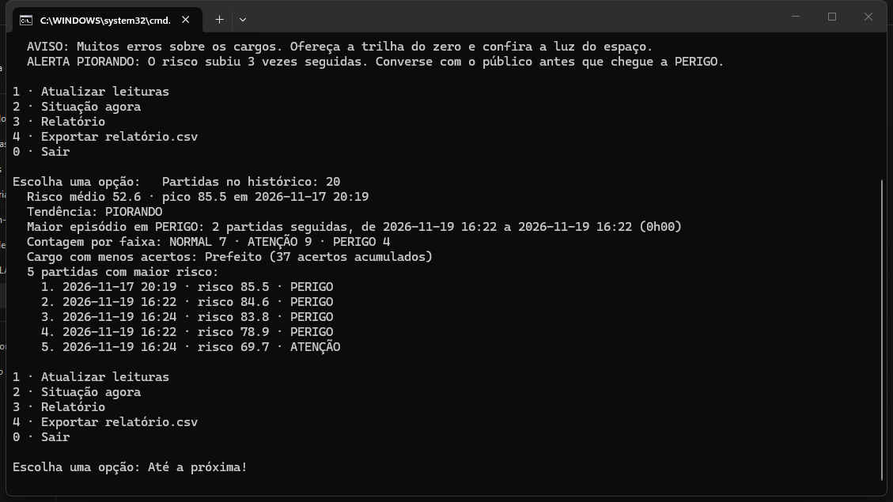

# Radar da Desinformação · O Cérebro Conectado (Python)

Parte de **Computational Thinking with Python** do projeto **Demokratos** (Global Solution 2026.2 · FIAP · Engenharia de Software · RJ).

O programa busca no ThingSpeak as estatísticas que o ESP32 do Radar da Desinformação publica depois de cada partida do quiz. Ele cruza duas medidas num índice de risco, classifica cada partida em NORMAL, ATENÇÃO ou PERIGO, percebe quando a situação está piorando e guarda o histórico.

**Quem usa:** o responsável pelo espaço onde fica a estação (biblioteca, escola ou espaço comunitário). Ele quer saber se o público está errando muito sobre os cargos políticos e se o espaço está bom para ler o quiz.

## Integrantes

| Nome | RM |
| --- | --- |
| Arthur Alen Amorelli Pereira | 571897 |
| Anna Júlia Elias Andrade | 573453 |
| Clara Diel Gama Secco | 571679 |

## Como rodar

Requisitos: Python 3.10 ou mais novo.

```bash
cd python
pip install -r requirements.txt
python main.py
```

O menu fica em loop até a opção **0 · Sair**:

| Opção | O que faz |
| --- | --- |
| 1 · Atualizar leituras | Busca as últimas entradas no ThingSpeak, junta ao histórico sem repetir e salva o `historico.json`. Sem rede, usa o `backup.json`. |
| 2 · Situação agora | Mostra a última partida, o índice de risco, a faixa, o aviso e o alerta de PIORANDO. |
| 3 · Relatório | Mostra risco médio, pico, tendência, maior episódio em PERIGO, contagem por faixa, cargo com menos acertos e as 5 partidas de maior risco. |
| 4 · Exportar relatorio.csv | Salva o histórico em `relatorio.csv`, com cabeçalho. |

## De onde vêm os dados

Dados do canal público do Radar no ThingSpeak, publicados pelo ESP32 simulado no Wokwi ([projeto no Wokwi](https://wokwi.com/projects/479911399606222849)). Nenhum dado pessoal é coletado: o quiz é anônimo.

As 4 primeiras partidas do canal (entry_id 1 a 4) foram jogadas no ESP32 simulado no Wokwi. Para chegar às 20 leituras pedidas na atividade, as partidas seguintes foram geradas pelo script `gerar_partidas.py`, que continua os totais acumulados no mesmo formato dos campos do ESP32. Cada um desses envios aparece no ThingSpeak com o status "simulado", como permite a regra da GS de usar dados simulados declarando a origem.

| Canal | Campos usados |
| --- | --- |
| Geral (3568353) | field3 = respostas acumuladas · field5 = erros acumulados · field7 = luz média do LDR durante a partida |
| Por cargo (3568360) | field1 a field5 = acertos acumulados de Prefeito, Governador, Vereador, Deputado e Presidente |

O ESP32 envia **totais acumulados** ao fim de cada partida. Por isso, o programa compara cada envio com o anterior: a diferença entre os dois é a partida. Cada leitura vira um dicionário `{id, horario, medidas, risco, faixa}`, em que `id` é o `entry_id` do ThingSpeak.

## Índice de risco

```
nivel = (valor - min) / (max - min) * 100      (limitado entre 0 e 100)
risco = 0,7 * nivel_taxa_erro + 0,3 * nivel_escuridao
```

| Medida | Mínimo | Máximo | Peso | Por quê |
| --- | --- | --- | --- | --- |
| Taxa de erro da partida (%) | 0 | 100 | 0,7 | É a medida principal do problema: quanto mais erros sobre quem faz o quê na política, maior o risco de desinformação. |
| Escuridão (leitura do LDR) | 0 | 4095 | 0,3 | É a faixa completa do conversor do ESP32. No Wokwi, quanto maior a leitura, mais escuro. Pouca luz atrapalha a leitura das perguntas no OLED, então pesa menos que os erros, mas entra no índice. |

**Faixas:** NORMAL abaixo de 40 · ATENÇÃO de 40 a 70 · PERIGO a partir de 70. **PIORANDO:** o risco subiu 3 vezes seguidas.

Os limites, os pesos e os avisos ficam no dicionário `CONFIG`, no início do `main.py`. Se os pesos não somarem 1, ou se um mínimo for maior ou igual ao máximo, o programa lança `ValueError` e não inicia.

| Situação | Aviso exibido |
| --- | --- |
| NORMAL | Bom conhecimento dos cargos. Indique a próxima trilha do Demokratos. |
| ATENÇÃO | Conhecimento mediano. Reforce a trilha "Quem faz o quê" com o público. |
| PERIGO | Muitos erros sobre os cargos. Ofereça a trilha do zero e confira a luz do espaço. |
| PIORANDO | O risco subiu 3 vezes seguidas. Converse com o público antes que chegue a PERIGO. |

## O que não derruba o programa

- **Sem rede, timeout ou status diferente de 200:** a `RequestException` é tratada e o programa usa o `backup.json`. Cada busca que dá certo atualiza o backup.
- **Arquivo ausente ou corrompido:** o histórico começa vazio, sem erro.
- **Entrada inválida no menu, Ctrl+C ou fim de entrada:** mensagem de aviso ou saída limpa.
- **Envio incompleto ou contador zerado no ESP32:** a partida é descartada, em vez de gerar uma taxa errada.

## Arquivos

| Arquivo | Conteúdo |
| --- | --- |
| `main.py` | Programa completo, dividido em funções com tipo e docstring |
| `backup.json` | Última resposta do ThingSpeak que deu certo (plano B) |
| `historico.json` | Todas as partidas já lidas, sem repetir `id` |
| `relatorio.csv` | Histórico exportado, separado por `;` |
| `gerar_partidas.py` | Script que envia ao ThingSpeak as partidas simuladas, marcadas como "simulado" |
| `prompts.md` | Registro do uso de IA |

## Integração com o Demokratos

- **Entra do Edge Computing:** as leituras que o ESP32 publica no ThingSpeak.
- **Entra do Software & Total Experience Design:** o menu, as faixas e os avisos vêm da jornada do responsável pelo espaço, definida no escopo.
- **Sai para o Front-end e o Web Development:** o `historico.json` e o `relatorio.csv` podem alimentar a página com a situação da estação.
- **Sai para o Pitch:** o programa buscando dados ao vivo entra no vídeo como prova.

## Execução


