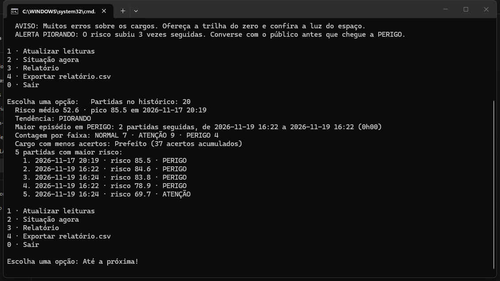

# Lógica · O Cérebro Conectado

Parte de **Computational Thinking with Python** da CitizenTech **Demokratos**.

## O que o programa faz

O programa busca no canal do ThingSpeak as estatísticas que o ESP32 do **Radar da Desinformação** publica ao fim de cada partida do quiz sobre cargos políticos. Ele cruza duas medidas de cada partida, a **taxa de erro** e a **escuridão do ambiente**, num Índice de Risco de desinformação. Depois, avisa o responsável pelo espaço (biblioteca, escola ou espaço comunitário) quando o público está errando muito ou quando a situação está piorando.

## Como rodar

1. Instale o Python 3.10 ou mais novo.
2. Instale a biblioteca de requisições, uma vez só:

   ```bash
   pip install requests
   ```

3. Abra esta pasta no terminal ou no PyCharm e rode:

   ```bash
   python main.py
   ```

Sem internet, o programa usa o `backup.json` e funciona do mesmo jeito.

| Opção do menu | O que faz |
|---|---|
| 1 · Atualizar leituras | Busca no ThingSpeak, junta ao histórico sem repetir e salva o `historico.json` |
| 2 · Situação agora | Última partida, Índice de Risco, faixa, aviso e alerta de PIORANDO |
| 3 · Relatório | Risco médio e pico, tendência, maior episódio em PERIGO, contagem por faixa, cargo com menos acertos e as 5 partidas de maior risco |
| 4 · Exportar relatório.csv | Salva o histórico em `relatorio.csv` |
| 0 · Sair | Encerra o programa (o menu só termina aqui) |

## De onde vêm os dados

- **Canal do ThingSpeak:** 3568353 (canal geral) · [thingspeak.com/channels/3568353](https://thingspeak.com/channels/3568353). Um segundo canal, o 3568360, guarda os acertos de cada cargo.
- **Endereço da API:** `https://api.thingspeak.com/channels/3568353/feeds.json?results=60`
- **Backup offline:** `backup.json`, com a lista `feeds` da resposta da API. Toda busca que dá certo atualiza o backup.
- **Origem dos valores:** as 4 primeiras partidas (entry_id 1 a 4) foram jogadas no ESP32 simulado no [Wokwi](https://wokwi.com/projects/479911399606222849). Para chegar às 20 leituras da atividade, as partidas 5 a 21 foram geradas pelo script `gerar_partidas.py`, que continua os totais no mesmo formato do ESP32. No ThingSpeak, cada um desses envios aparece com o status "simulado". Nenhum dado pessoal é coletado: o quiz é anônimo.

| Campo do canal | Medida | Unidade |
|---|---|---|
| `field3` | Respostas acumuladas desde o início | respostas |
| `field5` | Erros acumulados desde o início | erros |
| `field7` | Luz média do LDR durante a partida (no Wokwi, quanto maior, mais escuro) | leitura de 0 a 4095 |

O ESP32 envia **totais acumulados**. Por isso, o programa compara cada envio com o anterior: a diferença entre os dois é uma partida. A **taxa de erro** da partida é `erros da partida / respostas da partida × 100`, e a **escuridão** é o `field7` do envio. Cada leitura vira um dicionário `{id, horario, medidas, risco, faixa}`.

## Índice de Risco

```
nivel = (valor - min) / (max - min) * 100      (limitado entre 0 e 100)
risco = peso1 * nivel1 + peso2 * nivel2         (os pesos somam 1)
```

| Medida | Mínimo | Máximo | Peso | Por que esses números |
|---|---|---|---|---|
| Taxa de erro (%) | 0 | 100 | 0,7 | É a faixa completa de uma porcentagem: 0% é acertar tudo e 100% é errar tudo. É a medida principal do problema, porque errar quem faz o quê na política é o sinal mais direto de desinformação. Por isso, pesa mais. |
| Escuridão (LDR) | 0 | 4095 | 0,3 | É a faixa completa do conversor analógico do ESP32 (12 bits), a mesma que o circuito usa. Pouca luz atrapalha a leitura das perguntas no OLED e piora o resultado, mas não é o problema em si. Por isso, pesa menos. |

**Exemplo calculado à mão:** taxa de erro de 80% e escuridão de 3800 → níveis 80 e 92,8 → risco 0,7 × 80 + 0,3 × 92,8 = 83,8 → PERIGO. É a última partida do print abaixo.

## Faixas e avisos

São os mesmos textos usados na página do Demokratos e no escopo de Software & Total Experience Design.

| Faixa | Risco | Aviso |
|---|---|---|
| NORMAL | abaixo de 40 | Bom conhecimento dos cargos. Indique a próxima trilha do Demokratos. |
| ATENÇÃO | de 40 a 70 | Conhecimento mediano. Reforce a trilha "Quem faz o quê" com o público. |
| PERIGO | 70 ou mais | Muitos erros sobre os cargos. Ofereça a trilha do zero e confira a luz do espaço. |
| PIORANDO | 3 altas seguidas | O risco subiu 3 vezes seguidas. Converse com o público antes que chegue a PERIGO. |

## O que a equipe implementou

| Requisito | Função | Como resolvemos |
|---|---|---|
| 1 · Dados reais | `buscar_feeds` | `requests.get` com `timeout`, confere se o status é 200 e se a resposta tem a lista `feeds` |
| 2 · Plano B | `obter_feeds_com_plano_b` | Trata `RequestException` e `ValueError`, usa o `backup.json` e atualiza o backup a cada busca boa |
| 3 · Modelo | `extrair_medidas`, `montar_leituras` | Transforma dois envios seguidos numa partida e cada partida num dicionário |
| 4 · Decisão combinada | `calcular_nivel`, `calcular_risco`, `classificar_faixa`, `validar_config` | Fórmula da atividade. Pesos que não somam 1, mínimo maior ou igual ao máximo ou faixas fora de ordem disparam `ValueError` |
| 5 · Tendência | `calcular_tendencia` | Compara o risco das 4 últimas leituras: 3 altas seguidas = PIORANDO, 3 quedas = MELHORANDO, senão ESTÁVEL |
| 5 · Episódios | `maior_episodio_perigo`, `duracao_em_texto` | Percorre as leituras guardando o trecho atual em PERIGO e o maior já visto. Uma leitura fora de PERIGO encerra o trecho. A duração é a diferença entre o primeiro e o último horário |
| 5 · Contagem por faixa | `contar_por_faixa` | Dicionário contador com NORMAL, ATENÇÃO e PERIGO |
| 6 · Histórico sem duplicar | `mesclar_historico` | Guarda os `entry_id` do histórico num `set` e pula os que já existem |
| 6 · Relatório CSV | `exportar_csv` | Colunas `id;horario;taxa_erro;escuridao;risco;faixa`, separadas por `;`, com codificação que abre direto no Excel |
| Extra | `piores_leituras` | Ranking das 5 partidas de maior risco do histórico |
| Extra | `cargo_mais_fraco` | Lê o segundo canal e mostra o cargo com menos acertos, para orientar qual trilha reforçar |

## Arquivos que o programa gera

| Arquivo | Quando | O que tem |
|---|---|---|
| `backup.json` | a cada busca que dá certo | a última lista `feeds` da API |
| `historico.json` | a cada busca | todas as partidas já vistas, uma vez só |
| `relatorio.csv` | opção 4 do menu | o histórico em planilha, com cabeçalho |

## Robustez: o que já testamos

| Situação | O que o programa faz |
|---|---|
| Sem internet | Avisa "Sem acesso ao ThingSpeak" e usa o `backup.json` |
| Canal errado ou privado | O ThingSpeak responde com erro 4xx ou com `-1`. O programa trata como falha e usa o backup |
| Leitura com um campo vazio | A partida é descartada, em vez de gerar uma taxa errada |
| Contador do ESP32 zerado | A diferença negativa é descartada |
| Pesos que não somam 1 ou mínimo maior que o máximo | `ValueError`: o programa mostra o motivo e não inicia |
| `backup.json` ou `historico.json` apagado ou corrompido | Começa vazio, sem erro |
| Letra, Enter vazio ou número fora do menu | "Opção inválida" e o menu volta |
| Ctrl+C ou fim da entrada | Sai do menu sem mostrar erro |

## Integração com as outras partes

| Parte | Como conversa com o Python |
|---|---|
| Sensor · Edge | O programa lê pela API os campos que o ESP32 do Radar publica. A faixa da escuridão (0 a 4095) é a mesma leitura do LDR no circuito |
| Experiência · STXD | O menu, os avisos e o alerta de PIORANDO saíram da jornada do responsável pelo espaço, definida no escopo |
| Interface · Front-end | As faixas e os textos dos avisos são os mesmos da página |
| Interação · Web Dev | O `historico.json` ou o `relatorio.csv` podem alimentar a situação da estação na página |
| Pitch · Storytelling | O programa buscando dados ao vivo entra no vídeo como prova |

## Execução

Situação agora (com o alerta de PIORANDO) e relatório, com os dados do canal:



## Antes de enviar

- [x] O programa roda do início ao fim, e o menu só termina no **0 · Sair**
- [x] O código está em funções, cada uma com anotação de tipo, docstring e uma tarefa só
- [x] As leituras vêm da API do canal ThingSpeak da equipe, com 2 ou mais campos, em dicionários
- [x] Sem internet, o programa usa o `backup.json` e segue funcionando
- [x] O Índice de Risco usa mínimos, máximos e pesos do problema da equipe, justificados acima
- [x] O relatório mostra a tendência e o maior episódio em PERIGO
- [x] Rodar a opção 1 duas vezes não duplica nada no `historico.json`
- [x] A opção 4 gera o `relatorio.csv` com cabeçalho
- [x] Rede, arquivo, configuração e entrada inválida não derrubam o programa
- [x] Este README está preenchido, com print, e o `prompts.md` está atualizado
- [x] Todos os integrantes sabem explicar qualquer linha do `main.py`

## Equipe

| Nome completo | RM |
|---|---|
| Arthur Alen Amorelli Pereira | 571897 |
| Anna Júlia Elias Andrade | 573453 |
| Clara Diel Gama Secco | 571679 |
